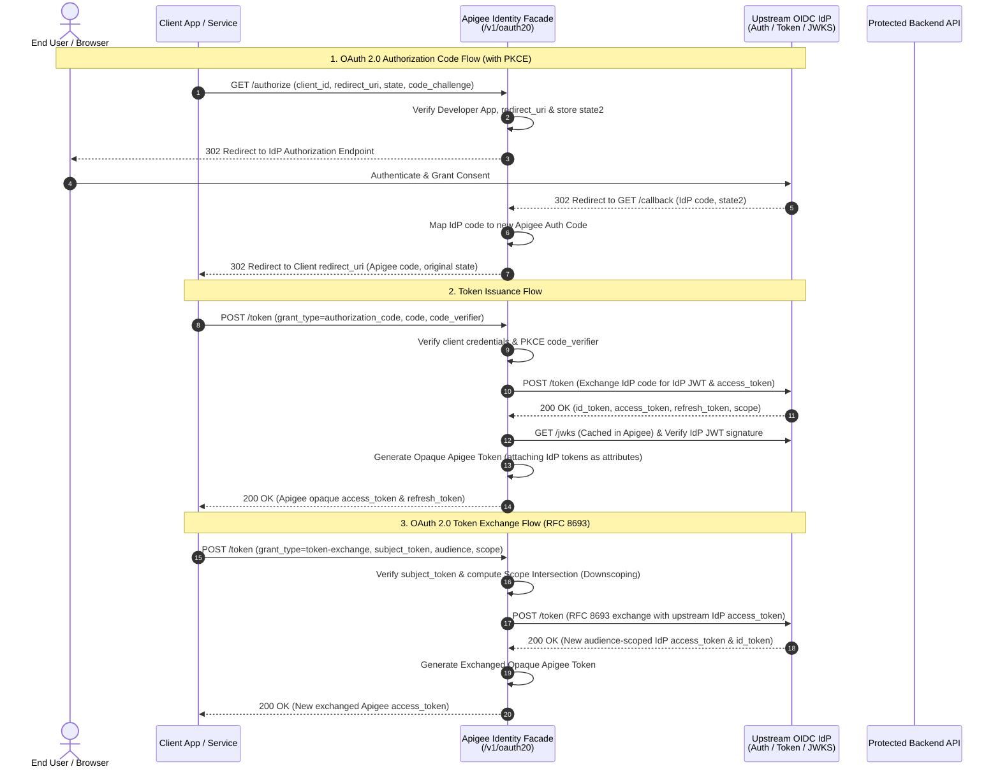

# Apigee Identity Facade (`identity-facade-v1`) — OAuth 2.0, OIDC & RFC 8693 Token Exchange

This repository contains the **Apigee Identity Facade (`identity-facade-v1`)** proxy bundle and comprehensive technical documentation. 

The Identity Facade acts as an OAuth 2.0 and OpenID Connect (OIDC) intermediary layer deployed on **Google Cloud Apigee**, bridging external client applications (Web, Mobile, Single-Page Apps, and AI Agents) with any OIDC-compliant Identity Provider (**IdP**) such as Okta, Auth0, Keycloak, Microsoft Entra ID (Azure AD), or Google Cloud Identity.

In addition to standard OAuth 2.0 Authorization Code (with PKCE) and Refresh Token flows, this implementation features native support for **OAuth 2.0 Token Exchange ([RFC 8693](https://datatracker.ietf.org/doc/html/rfc8693))**, enabling zero-trust service-to-service delegation, audience restriction, and automatic scope downscoping.

---

## 🏛️ Architectural Principles & Separation of Concerns

The Apigee Identity Facade enforces a strict **separation of concerns** between API Management (Apigee) and Identity Management (IdP):

| Layer | Responsibility | Key Capabilities |
| :--- | :--- | :--- |
| **Apigee API Management** | **Client Application Authentication & API Governance** | • Authenticates API consumers via Apigee Developer Apps (`client_id` / `client_secret`)<br>• Enforces traffic management, quotas, and spike arrests<br>• Validates `redirect_uri` and **PKCE** (`S256`) challenges<br>• Issues **opaque Apigee OAuth 2.0 tokens** to external clients<br>• Translates opaque tokens to upstream IdP JWTs/tokens at the API gateway edge |
| **Upstream OIDC IdP** | **End-User Authentication & Identity Federation** | • Authenticates end-users (MFA, SSO, Passkeys, Social Login)<br>• Manages user consent and identity profiles<br>• Issues signed cryptographic JWTs (`id_token` and upstream `access_token`)<br>• Evaluates upstream **RFC 8693 Token Exchange** trust policies |

### Why Use Opaque Tokens Externally and JWTs Internally?

1. **Zero Upstream Credential Exposure:** Client applications never see or handle upstream IdP access tokens, refresh tokens, or internal JWT claims. They only receive an opaque Apigee token.
2. **Centralized Revocation & Governance:** Apigee can immediately revoke client access or enforce per-app rate limits without requiring upstream IdP configuration changes.
3. **Seamless Token Translation:** When a client calls an API proxy on Apigee presenting its opaque access token, Apigee verifies the token (`OAuthV2: VerifyAccessToken`) and automatically loads the associated upstream IdP tokens (`accesstoken.idp.access_token`, `accesstoken.idp.jwt`, `accesstoken.idp.scope`) into Apigee flow variables to forward to backend microservices.

---

## 🌐 High-Level Architecture & Flow Overview



---

## 📑 API Endpoints Reference (`BasePath: /v1/oauth20`)

The proxy exposes four primary functional endpoints over HTTPS (`VirtualHost: secure`):

| Endpoint | HTTP Verb | Flow Name | Description |
| :--- | :---: | :--- | :--- |
| `/v1/oauth20/authorize` | `GET` | `GET /authorize` | Initiates the OAuth 2.0 Authorization Code flow (supports PKCE `S256` and CSRF `state`). |
| `/v1/oauth20/callback` | `GET` | `GET /callback` | Receives the authorization code callback from the upstream IdP and redirects to the client app. |
| `/v1/oauth20/token` | `POST` | `POST /token (exchange)` | **RFC 8693 Token Exchange** endpoint (`grant_type=urn:ietf:params:oauth:grant-type:token-exchange`). |
| `/v1/oauth20/token` | `POST` | `POST /token (issuance)` | Standard OAuth 2.0 token endpoint supporting `authorization_code` and `refresh_token` grants. |
| `/v1/oauth20/protected` | `GET` | `GET /protected` | Demo protected endpoint that validates an Apigee access token and fetches `/userinfo` from the IdP. |

---

## 🔐 Deep Dive: OAuth 2.0 Token Exchange (RFC 8693)

### 1. Purpose & Use Cases
Modern distributed architectures—including microservice meshes and **Agentic AI / Model Context Protocol (MCP)** workflows—frequently require an intermediate service or AI agent to call a downstream resource server on behalf of an authenticated user.

Passing the user's initial high-privilege access token across multiple downstream services violates the **Principle of Least Privilege**. The **RFC 8693 Token Exchange** implementation in `identity-facade-v1` solves this by enabling a client to exchange an existing Apigee access token (`subject_token`) for a **new, narrowly scoped access token** bound to a specific target `audience` and a reduced set of `scope` permissions.

### 2. How RFC 8693 Token Exchange Works in Apigee

When a client sends a `POST /v1/oauth20/token` request with `grant_type=urn:ietf:params:oauth:grant-type:token-exchange`, the proxy executes the following 8-stage pipeline:

#### Stage 1: Client Authentication & Upstream Credential Mapping
* **Policy:** `VAK-VerifyAPIKey-FormParam` & conditional check on `client_secret`.
* Apigee authenticates the calling client using `request.formparam.client_id` and `request.formparam.client_secret`.
* **Dynamic IdP Mapping:** The policy automatically retrieves two custom attributes configured on the Apigee Developer App:
  * `idp_client_id` (`verifyapikey.VAK-VerifyAPIKey-FormParam.idp_client_id`)
  * `idp_client_secret` (`verifyapikey.VAK-VerifyAPIKey-FormParam.idp_client_secret`)
* This allows Apigee to map each Developer App to its corresponding confidential client identity registered in the upstream IdP.

#### Stage 2: Strict RFC 8693 Parameter Validation
Apigee validates all mandatory RFC 8693 parameters before touching the token store:
* `subject_token_type` **MUST** equal `urn:ietf:params:oauth:token-type:access_token`. Any other value triggers `RF-UnsupportedTokenType` (`HTTP 400 Bad Request` with `{"error":"unsupported_token_type"}`).
* `subject_token`, `audience`, and `scope` **MUST** be present and non-empty. Missing parameters trigger `RF-InvalidRequest` (`HTTP 400 Bad Request` with `{"error":"invalid_request"}`).

#### Stage 3: Subject Token Verification & Attribute Extraction
* **Policy:** `OA2-VerifySubjectToken` (`OAuthV2: VerifyAccessToken`).
* Apigee validates that the opaque `subject_token` passed in the form body is active and not expired.
* Upon verification, Apigee populates flow variables with the upstream IdP metadata originally attached to that token:
  * `accesstoken.idp.access_token`: The original upstream IdP access token.
  * `accesstoken.idp.scope`: The space-delimited list of scopes originally granted by the IdP.

#### Stage 4: Automatic Scope Downscoping (Least Privilege Enforcement)
* **Policy:** `JS-AllowedScopesForTokenExchange` (`resources/jsc/JS-AllowedScopesForTokenExchange.js`).
* To prevent privilege escalation, the JavaScript policy compares the requested scopes (`request.formparam.scope`) against the scopes attached to the original subject token (`accesstoken.idp.scope`).
* It calculates the **strict mathematical intersection** of the two scope lists and stores the result in `flow.apigee.scopesForExchange`:
  ```javascript
  // Example:
  // Original token scopes (accesstoken.idp.scope): "openid profile email orders:read orders:write"
  // Requested exchange scopes (request.formparam.scope): "orders:read admin:delete"
  // Resulting exchanged scopes (flow.apigee.scopesForExchange): "orders:read"
  ```
* Any scope requested by the client that was not present in the original token is silently stripped out.

#### Stage 5: Upstream IdP Token Exchange Callout
* **Policies:** `AM-BuildIdPExchangeTokenRequest`, `KVM-IdpParameters`, and `SC-IdPExchangeToken`.
* Apigee constructs a standard RFC 8693 `application/x-www-form-urlencoded` POST request to the upstream IdP's token endpoint (`https://{private.flow.idp.token.hostname}/{private.flow.idp.token.uri}`):
  * `client_id`: `{verifyapikey.VAK-VerifyAPIKey-FormParam.idp_client_id}`
  * `client_secret`: `{verifyapikey.VAK-VerifyAPIKey-FormParam.idp_client_secret}`
  * `grant_type`: `urn:ietf:params:oauth:grant-type:token-exchange`
  * `subject_token`: `{accesstoken.idp.access_token}` *(Translates the opaque Apigee token into the real upstream IdP token!)*
  * `subject_token_type`: `urn:ietf:params:oauth:token-type:access_token`
  * `audience`: `{request.formparam.audience}`
  * `scope`: `{flow.apigee.scopesForExchange}` *(Enforces the downscoped permissions)*

#### Stage 6: Upstream Response Extraction & Expiry Calculation
* **Policies:** `EV-ExtractDataFromIdpTokenExchange` & `JS-SetAccessTokenExpiry`.
* Apigee extracts the newly minted upstream `access_token`, `id_token`, `refresh_token`, `scope`, and `expires_in` from the IdP's JSON response.
* `JS-SetAccessTokenExpiry` converts the IdP's `expires_in` value (in seconds) into milliseconds (`private.flow.idp.expires_in`) so the new Apigee token's lifetime matches the upstream IdP token's lifetime.

#### Stage 7: Exchanged Opaque Token Generation
* **Policies:** `AM-SetGrantTypeAsFormParam` & `OA2-GenerateExchangedAccessToken`.
* Because Apigee's `OAuthV2` policy (`GenerateAccessToken` operation) natively requires a supported internal grant type to mint an opaque token, `AM-SetGrantTypeAsFormParam` temporarily sets `request.formparam.grant_type=client_credentials` and `request.formparam.scope={flow.idp.scope}`.
* `OA2-GenerateExchangedAccessToken` generates the new opaque Apigee access token, binding the newly exchanged upstream IdP tokens (`idp.access_token`, `idp.jwt`, `idp.refresh_token`, `idp.scope`, `idp.expires_in`) as custom attributes on the token.

---

### 3. Token Exchange API Specification

#### Request Example (`curl`)

```bash
curl -X POST "https://${APIGEE_HOST}/v1/oauth20/token" \
  -H "Content-Type: application/x-www-form-urlencoded" \
  -d "grant_type=urn:ietf:params:oauth:grant-type:token-exchange" \
  -d "client_id=YOUR_APIGEE_CLIENT_ID" \
  -d "client_secret=YOUR_APIGEE_CLIENT_SECRET" \
  -d "subject_token=ORIGINAL_APIGEE_OPAQUE_ACCESS_TOKEN" \
  -d "subject_token_type=urn:ietf:params:oauth:token-type:access_token" \
  -d "audience=https://inventory-service.internal.example.com" \
  -d "scope=openid orders:read"
```

#### Request Parameters (`application/x-www-form-urlencoded`)

| Parameter | Required | Expected Value / Format | Description |
| :--- | :---: | :--- | :--- |
| `grant_type` | **Yes** | `urn:ietf:params:oauth:grant-type:token-exchange` | Identifies the request as an RFC 8693 Token Exchange. |
| `client_id` | **Yes** | String | The Apigee Developer App Client ID (Consumer Key). |
| `client_secret` | **Yes** | String | The Apigee Developer App Client Secret (Consumer Secret). |
| `subject_token` | **Yes** | Opaque Token String | The active Apigee OAuth 2.0 `access_token` to be exchanged. |
| `subject_token_type` | **Yes** | `urn:ietf:params:oauth:token-type:access_token` | Indicates that `subject_token` is an OAuth 2.0 access token. |
| `audience` | **Yes** | URI / String | The logical identifier of the target service/resource for which the new token is requested. |
| `scope` | **Yes** | Space-delimited String | Desired scopes for the new token (automatically downscoped to the intersection with the subject token's scopes). |

#### Successful Response (`200 OK`)

```json
{
  "access_token": "8a9b7c6d5e4f3a2b1c0d9e8f7a6b5c4d",
  "token_type": "Bearer",
  "expires_in": 1799,
  "scope": "openid orders:read"
}
```

#### Error Responses (RFC 6749 & RFC 8693 Compliant)

| HTTP Status | Error Code | Trigger Condition | Policy Name |
| :---: | :--- | :--- | :--- |
| `400 Bad Request` | `{"error": "invalid_request"}` | Missing or empty `subject_token`, `audience`, or `scope`. | `RF-InvalidRequest` |
| `400 Bad Request` | `{"error": "unsupported_token_type"}` | `subject_token_type` is not `urn:ietf:params:oauth:token-type:access_token`. | `RF-UnsupportedTokenType` |
| `401 Unauthorized` | `{"error": "invalid_client"}` | Invalid `client_id` or `client_secret` mismatch. | `RF-InvalidClient` |
| `401 Unauthorized` | `Invalid Access Token` | The provided `subject_token` is expired, revoked, or invalid in Apigee. | `OA2-VerifySubjectToken` |

---

## 🔄 Standard OAuth 2.0 & OIDC Flows

In addition to Token Exchange, `identity-facade-v1` provides complete OAuth 2.0 / OIDC facade capabilities:

### 1. Authorization Request (`GET /v1/oauth20/authorize`)
* **Anti-Forgery State Token (CSRF Protection):** Clients pass an opaque `state` parameter. Apigee generates a secondary internal state token (`state2`) via `OA2-GenerateAzCode-State2` to persist the client's context (`client_id`, `redirect_uri`, `scope`, `state`, and `code_challenge`) while redirecting the browser to the IdP.
* **PKCE Support ([RFC 7636](https://datatracker.ietf.org/doc/html/rfc7636)):** Enabled by default via `AM-SetPKCEMode` (`flow.pkce.enabled = "true"`). Enforces `code_challenge` and `code_challenge_method=S256`.

### 2. Callback Handling (`GET /v1/oauth20/callback`)
* Receives the upstream IdP's authorization `code` and `state2`.
* Restores the client context (`OA2-AttributesFromAzCode-State2`) and stores the external IdP authorization code (`OA2-StoreExternalAuthorizationCode-PKCE`).
* Issues an Apigee-managed authorization code and redirects (`302 Found`) back to the client application's registered `redirect_uri` with the original `state`.

### 3. Token Issuance & Refresh (`POST /v1/oauth20/token`)
* **Authorization Code Grant (`grant_type=authorization_code`):**
  * Supports client authentication via HTTP Basic Auth (`Authorization: Basic ...`) or form body parameters.
  * Verifies the PKCE `code_verifier` against the SHA-256 hash of the stored `code_challenge` (`JS-PKCECodeVerification`).
  * Exchanges the stored upstream IdP code for IdP tokens (`SC-IdpTokenIssuance`).
  * Fetches and caches the IdP's JWKS public keys (`LC-GetJWKS` / `SC-GetJwksFromIdp` / `PC-CacheJWKS`) and cryptographically verifies the IdP `id_token` (`VJ-VerifyJwtFromIdp`).
  * Issues an Apigee opaque `access_token` and `refresh_token` (`OA2-GenerateAccessToken`).
* **Refresh Token Grant (`grant_type=refresh_token`):**
  * Loads the stored upstream `idp.refresh_token` from the Apigee refresh token (`OA2-GetRefreshTokenAttributes`).
  * Calls the IdP token endpoint to obtain fresh upstream tokens (`AM-BuildIdpRefreshTokenRequest` -> `SC-IdpTokenIssuance`).
  * Issues a new Apigee opaque token pair and updates the stored token attributes (`OA2-GenerateRefreshToken` & `OA2-SetUpdateTokenAttributes`).

---

## ⚙️ Configuration & Setup Requirements

To deploy and operate `identity-facade-v1` in an Apigee environment, the following Apigee resources and configurations are required. You can provision them either **automatically** via the reference deployment pipeline (which parses your IdP's OpenID Connect Discovery Document) or **manually**.

### 1. Environment Key Value Map (KVM): `idpConfigIdentityProxy`
An environment-scoped KVM named **`idpConfigIdentityProxy`** stores your upstream IdP endpoints.

> **💡 Automatic KVM Creation from OIDC Discovery Document:**  
> When using the automated deployment script ([`pipeline.sh`](./pipeline.sh)), **you do not need to populate this KVM manually**. By providing your IdP's discovery URL via the `IDP_DISCOVERY_DOCUMENT` environment variable (`https://<idp-domain>/.well-known/openid-configuration`), the script automatically fetches the JSON document, extracts `issuer`, `authorization_endpoint`, `token_endpoint`, `jwks_uri`, and `userinfo_endpoint`, splits each URL into its hostname and URI path components, and uses [`apigeecli`](https://github.com/apigee/apigeecli) to create and populate `idpConfigIdentityProxy` automatically.

| KVM Key | Example Value | Description |
| :--- | :--- | :--- |
| `idp.issuer` | `https://idp.example.com/oauth2/default` | Expected `iss` claim in upstream IdP ID Tokens (`id_token`). Extracted from `.issuer`. |
| `idp.az.hostname` | `idp.example.com` | Hostname of the IdP Authorization endpoint. Extracted from `.authorization_endpoint`. |
| `idp.az.uri` | `oauth2/default/v1/authorize` | Path of the IdP Authorization endpoint. Extracted from `.authorization_endpoint`. |
| `idp.token.hostname` | `idp.example.com` | Hostname of the IdP Token endpoint. Extracted from `.token_endpoint`. |
| `idp.token.uri` | `oauth2/default/v1/token` | Path of the IdP Token endpoint (issuance, refresh, RFC 8693 exchange). Extracted from `.token_endpoint`. |
| `idp.jwks.hostname` | `idp.example.com` | Hostname of the IdP JWKS endpoint. Extracted from `.jwks_uri`. |
| `idp.jwks.uri` | `oauth2/default/v1/keys` | Path of the IdP JWKS public keys endpoint. Extracted from `.jwks_uri`. |
| `idp.userinfo.hostname` | `idp.example.com` | Hostname of the IdP OIDC UserInfo endpoint. Extracted from `.userinfo_endpoint`. |
| `idp.userinfo.uri` | `oauth2/default/v1/userinfo` | Path of the IdP OIDC UserInfo endpoint. Extracted from `.userinfo_endpoint`. |

*(Note: The deployment script also populates `idp.apigee.client_id`, `idp.apigee.client_secret`, and `idp.apigee.redirect_uri` in the KVM. In this Revision 38 proxy bundle, per-application credentials and redirect URIs are dynamically loaded from Developer App Custom Attributes as detailed below.)*

### 2. Environment Cache: `IDP_JWKS_CACHE`
An environment-scoped cache named **`IDP_JWKS_CACHE`** is used by `LC-GetJWKS` and `PC-CacheJWKS` to cache the cryptographic JWKS public keys fetched from the IdP's `jwks_uri` (default TTL: `1800` seconds / 30 minutes), preventing redundant network round-trips during JWT verification (`VJ-VerifyJwtFromIdp`).

### 3. Apigee Developer App Custom Attributes
Each client application registered as an **Apigee Developer App** that consumes the Identity Facade must define the following Custom Attributes (automatically configured for the test app `identityApp` when using `./pipeline.sh`):

| Custom Attribute Name | Required For | Description |
| :--- | :---: | :--- |
| `redirection_uris` / `redirect_uris` | `/authorize` & `/token` | Comma-separated list or single URI of allowed OAuth 2.0 callback Redirect URIs for this app (`JS-ValidateRedirectURI_Authz` & `JS-ValidateRedirectURI_Token`). |
| `idp_client_id` | `/authorize` & `/token` | The upstream IdP Client ID associated with this Apigee Developer App. |
| `idp_client_secret` | `/token` (Token Exchange & Issuance) | The upstream IdP Client Secret associated with this Apigee Developer App. |
| `idp_redirect_uri` | `/authorize` & `/token` | The Apigee callback URI registered on the upstream IdP (`https://<apigee-hostname>/v1/oauth20/callback`). |

---

## 🚀 Automated Installation & Deployment (`pipeline.sh`, `summary.sh` & `cleanup.sh`)

This repository includes three strictly **POSIX-compliant (`#!/bin/sh`)** scripts powered by **[`apigeecli`](https://github.com/apigee/apigeecli)**:
* **[`pipeline.sh`](./pipeline.sh):** Automated deployment pipeline that provisions the KVM, API Proxy, API Product, Developer, Cache, and Developer App, and prints the end-to-end testing summary.
* **[`summary.sh`](./summary.sh):** **100% Read-Only** script that inspects your Apigee organization/environment (without creating or modifying anything on Apigee or Google Cloud), verifies if `identity-facade-v1` is deployed, and regenerates the exact same 7-section deployment summary and ready-to-run `curl` commands.
* **[`cleanup.sh`](./cleanup.sh):** Cleanup script that removes all Apigee resources provisioned by `pipeline.sh`.

### Key Modernizations in `pipeline.sh`
* **100% Powered by `apigeecli`:** Replaces the legacy `sackmesser` tool with [`apigeecli`](https://github.com/apigee/apigeecli) (`apigeecli kvms`, `apigeecli apis`, `apigeecli products`, `apigeecli developers`, `apigeecli apps`). Automatically installs `apigeecli` in `~/.apigeecli/bin` if not already present in `PATH`.
* **PKCE (`S256`) Enabled by Default:** Enforces **PKCE (`S256`) by default** (`DEFAULT_IS_PKCE_ENABLED=true`). Automatically generates `apiproxy/policies/AM-SetPKCEMode.xml` from [`AM-SetPKCEMode.template.xml`](./AM-SetPKCEMode.template.xml) with `flow.pkce.enabled=true` and outputs an Authorization URL pre-configured with `code_challenge_method=S256` and a valid SHA-256 `code_challenge`.
* **Modern Apigee X / hybrid API Product (`operationGroup`):** Uses `apigeecli products create/update --opgrp` with the modern Apigee v1 **`operationGroup`** (`operationConfigType: "proxy"`) defining explicit operations for `/authorize` (`GET`), `/callback` (`GET`), `/token` (`POST`), `/protected` (`GET`), and `/**`.
* **Automatic Developer App Custom Attributes:** Uses `apigeecli apps create/update --attrs` and `apigeecli apps keys create` to automatically populate `redirection_uris`, `redirect_uris`, `idp_client_id`, `idp_client_secret`, and `idp_redirect_uri` on the provisioned `identityApp` Developer App.

### Prerequisites & Dependencies
* `curl` and `jq` (used by `pipeline.sh` to parse the OIDC Discovery Document)
* `gcloud` CLI (authenticated with Apigee Organization Admin permissions for Apigee X / hybrid)
* [`apigeecli`](https://github.com/apigee/apigeecli) (automatically downloaded to `~/.apigeecli/bin` by `pipeline.sh` if not already installed in `PATH`)

### Environment Configuration Variables

| Variable | Required | Default | Description |
| :--- | :---: | :--- | :--- |
| `APIGEE_X_ORG` | **Yes** | `PROJECT_ID` / `gcloud` project | Target Apigee X or Apigee hybrid Organization ID. |
| `APIGEE_X_ENV` | **Yes** | `APIGEE_ENV` | Target Apigee Environment name (e.g., `prod`, `dev`, `test`). |
| `APIGEE_X_HOSTNAME` | **Yes** | — | Target Apigee Environment Group hostname (e.g., `api.example.com`). |
| `IDP_DISCOVERY_DOCUMENT` | **Recommended** | `oidc-mock` URL | URL of your IdP's OIDC Discovery Document (`https://<idp>/.well-known/openid-configuration`). |
| `TEST_IDP_APIGEE_CLIENT_ID` | Optional | `dummy-client_id-apigee123` | Upstream IdP `client_id` stored in the KVM and on `identityApp` (`idp_client_id`). |
| `TEST_IDP_APIGEE_CLIENT_SECRET` | Optional | `dummy-client_secret_apigee456` | Upstream IdP `client_secret` stored in the KVM and on `identityApp` (`idp_client_secret`). |
| `APP_REDIRECT_URI` | Optional | `https://mocktarget.apigee.net/echo` | Allowed client application callback `redirect_uri` configured on `identityApp`. |
| `IS_PKCE_ENABLED` | Optional | **`true`** (Enabled by default) | Controls PKCE (`S256`) enforcement in `AM-SetPKCEMode.xml`. Set `export IS_PKCE_ENABLED=false` only if you explicitly wish to disable PKCE. |

### Quick Start Deployment

```bash
# 1. Set Apigee X / hybrid environment variables
export APIGEE_X_ORG="<your-apigee-x-org-id>"
export APIGEE_X_ENV="<your-apigee-x-env-name>"
export APIGEE_X_HOSTNAME="<your-apigee-env-group-hostname>"

# 2. Configure upstream OIDC IdP Discovery Document & credentials
export IDP_DISCOVERY_DOCUMENT="https://idp.example.com/.well-known/openid-configuration"
export TEST_IDP_APIGEE_CLIENT_ID="your-idp-client-id"
export TEST_IDP_APIGEE_CLIENT_SECRET="your-idp-client-secret"

# Note: PKCE (S256) is ENABLED by default (IS_PKCE_ENABLED=true).
# To disable PKCE, uncomment the following line:
# export IS_PKCE_ENABLED=false

# 3. Execute automated deployment pipeline
./pipeline.sh
```

### Pipeline Execution Steps (`./pipeline.sh`)

When `./pipeline.sh` runs, it performs the following automated steps via `apigeecli`:
1. **PKCE Configuration (`set_pkce_config`):** Sets `flow.pkce.enabled` to `true` (default) in `apiproxy/policies/AM-SetPKCEMode.xml`.
2. **OIDC Discovery Parsing (`set_idp_env_var`):** Fetches `GET $IDP_DISCOVERY_DOCUMENT`, validates the JSON response, and extracts `issuer`, `authorization_endpoint`, `token_endpoint`, `jwks_uri`, and `userinfo_endpoint`, splitting each URL into hostname and URI path components.
3. **Environment KVM (`apigeecli kvms`):** Creates `idpConfigIdentityProxy` and upserts all discovered IdP endpoints and credentials (`apigeecli kvms entries create/update`).
4. **API Proxy Deployment (`apigeecli apis create bundle`):** Packages and deploys `identity-facade-v1` to `$APIGEE_X_ENV`.
5. **Modernized API Product (`apigeecli products create/update --opgrp`):** Creates or updates the `IdentityFacade` API Product with separated `operationConfigs` entries covering `/authorize`, `/callback`, `/token`, `/protected`, and `/**`.
6. **Developer, Cache & Developer App (`apigeecli developers`, `apigeecli cache`, `apigeecli apps`):** Creates developer `janedoe@example.com`, provisions environment cache `IDP_JWKS_CACHE`, creates/updates Developer App `identityApp` with all required custom attributes (`redirection_uris`, `redirect_uris`, `idp_client_id`, `idp_client_secret`, `idp_redirect_uri`), and registers custom client credentials (`apigeecli apps keys create`).
7. **Comprehensive Deployment Summary & End-to-End `curl` Commands (`generate_authz_url`):** Outputs a structured 6-part summary with all extracted configurations, the browser Authorization URL, and ready-to-copy `curl` commands pre-populated with your environment hostname, client credentials, and PKCE parameters.

---

## 📋 Understanding & Using the `pipeline.sh` Deployment Output (End-to-End Testing Guide)

At the end of execution, `./pipeline.sh` prints a **7-section Deployment Summary** where all `curl` commands use **environment variables** (`${APIGEE_HOST}`, `${CLIENT_ID}`, `${CLIENT_SECRET}`, `${REDIRECT_URI}`, `${PKCE_CODE_VERIFIER}`, `${APIGEE_AUTH_CODE}`, `${APIGEE_ACCESS_TOKEN}`, `${APIGEE_REFRESH_TOKEN}`, `${TARGET_AUDIENCE}`, `${EXCHANGE_SCOPE}`). This enables a **100% copy/paste workflow without manually editing any `curl` command**.

### Summary of Environment Variables Across Steps

| Step | Environment Variable(s) | How It Is Set |
| :--- | :--- | :--- |
| **Step 0 (Initial Setup)** | `APIGEE_HOST`, `CLIENT_ID`, `CLIENT_SECRET`, `REDIRECT_URI`, `SCOPE`, `PKCE_CODE_CHALLENGE`, `PKCE_CODE_VERIFIER`, `TARGET_AUDIENCE`, `EXCHANGE_SCOPE` | Copy/pasted once from **Section 3 (Step 0)** of the `./pipeline.sh` output. |
| **Step 1 (After Browser Login)** | `APIGEE_AUTH_CODE` | Exported manually with the `code` query parameter from the browser redirect URL (`export APIGEE_AUTH_CODE="..."`). |
| **Step 2 (Token Issuance)** | `APIGEE_ACCESS_TOKEN`, `APIGEE_REFRESH_TOKEN` | Automatically extracted via `jq` and exported by the Step 2 command block. |
| **Step 3b (Token Refresh)** | `APIGEE_ACCESS_TOKEN`, `APIGEE_REFRESH_TOKEN` | Automatically updated via `jq` and exported by the Step 3b command block. |
| **Step 4 (RFC 8693 Exchange)** | `EXCHANGED_ACCESS_TOKEN` | Automatically extracted via `jq` and exported by the Step 4 command block. |

---

### Step-by-Step Usage Guide

#### 1. Configure the Upstream OIDC IdP (`Section 1`)
Ensure the **`Apigee Callback URL (IdP Redirect URI)`** printed in **Section 1** (`https://<APIGEE_X_HOSTNAME>/v1/oauth20/callback`) is registered in the **Valid Redirect URIs** of your upstream IdP client (`$TEST_IDP_APIGEE_CLIENT_ID`, e.g., in Keycloak).

#### 2. Export Session Environment Variables (`Section 3 — Step 0`)
Copy/paste the `export` block printed in **Section 3** of `./pipeline.sh` once in your terminal:
```bash
export APIGEE_HOST="34.54.87.114.nip.io"
export CLIENT_ID="xkey-1790112785"
export CLIENT_SECRET="xsecret"
export REDIRECT_URI="https://mocktarget.apigee.net/echo"
export SCOPE="openid email profile"
export PKCE_CODE_CHALLENGE="hoLP4vNbBccHkhNAbk_jbyLhlGwgeoRyo53A-Luiirg"
export PKCE_CODE_VERIFIER="iloveapis1234567890"
export TARGET_AUDIENCE="apigee-client-identity-app"
export EXCHANGE_SCOPE="openid email"
```

#### 3. Authenticate in Browser & Export `APIGEE_AUTH_CODE` (`Section 4 — Step 1`)
1. Open the **Authorization URL** printed in **Section 4** in your browser and authenticate with your IdP.
2. After redirection to `https://mocktarget.apigee.net/echo?code=<CODE>&state=abcd-1234`, copy the `code` value and export the intermediate environment variable **`APIGEE_AUTH_CODE`**:
   ```bash
   export APIGEE_AUTH_CODE="<PASTE_CODE_FROM_BROWSER_HERE>"
   ```

#### 4. Exchange Authorization Code for Apigee Tokens (`Section 5 — Step 2`)
Copy/paste the **Step 2** block as-is (without editing anything). It uses `${APIGEE_AUTH_CODE}` and `${SCOPE}`, and automatically exports **`APIGEE_ACCESS_TOKEN`** and **`APIGEE_REFRESH_TOKEN`** for the next steps:
```bash
TOKEN_RESPONSE=$(curl -s -X POST "https://${APIGEE_HOST}/v1/oauth20/token" \
  -H "Content-Type: application/x-www-form-urlencoded" \
  -d "grant_type=authorization_code" \
  -d "client_id=${CLIENT_ID}" \
  -d "client_secret=${CLIENT_SECRET}" \
  -d "redirect_uri=${REDIRECT_URI}" \
  -d "scope=${SCOPE}" \
  -d "code=${APIGEE_AUTH_CODE}" \
  -d "code_verifier=${PKCE_CODE_VERIFIER}")
echo "$TOKEN_RESPONSE" | jq .
export APIGEE_ACCESS_TOKEN=$(echo "$TOKEN_RESPONSE" | jq -r '.access_token')
export APIGEE_REFRESH_TOKEN=$(echo "$TOKEN_RESPONSE" | jq -r '.refresh_token')
```

#### 5. Call Protected Endpoint & Refresh Token (`Section 6 — Step 3`)
Copy/paste either block as-is (both use `${APIGEE_ACCESS_TOKEN}` and `${APIGEE_REFRESH_TOKEN}` already exported in Step 2):
* **a) Call Protected Endpoint (`GET /v1/oauth20/protected`):**
  ```bash
  curl -i -X GET "https://${APIGEE_HOST}/v1/oauth20/protected" \
    -H "Authorization: Bearer ${APIGEE_ACCESS_TOKEN}"
  ```
* **b) Refresh Opaque Access Token (`POST /v1/oauth20/token`):**
  Automatically updates **`APIGEE_ACCESS_TOKEN`** and **`APIGEE_REFRESH_TOKEN`** with the newly rotated tokens:
  ```bash
  REFRESH_RESPONSE=$(curl -s -X POST "https://${APIGEE_HOST}/v1/oauth20/token" \
    -H "Content-Type: application/x-www-form-urlencoded" \
    -d "grant_type=refresh_token" \
    -d "client_id=${CLIENT_ID}" \
    -d "client_secret=${CLIENT_SECRET}" \
    -d "refresh_token=${APIGEE_REFRESH_TOKEN}")
  echo "$REFRESH_RESPONSE" | jq .
  export APIGEE_ACCESS_TOKEN=$(echo "$REFRESH_RESPONSE" | jq -r '.access_token')
  export APIGEE_REFRESH_TOKEN=$(echo "$REFRESH_RESPONSE" | jq -r '.refresh_token')
  ```

#### 6. Execute an RFC 8693 Token Exchange (`Section 7 — Step 4`)
Copy/paste the **Step 4** block as-is. It exchanges `${APIGEE_ACCESS_TOKEN}` for a new audience-restricted, downscoped token and exports it into **`EXCHANGED_ACCESS_TOKEN`**:
```bash
EXCHANGE_RESPONSE=$(curl -s -X POST "https://${APIGEE_HOST}/v1/oauth20/token" \
  -H "Content-Type: application/x-www-form-urlencoded" \
  -d "grant_type=urn:ietf:params:oauth:grant-type:token-exchange" \
  -d "client_id=${CLIENT_ID}" \
  -d "client_secret=${CLIENT_SECRET}" \
  -d "subject_token=${APIGEE_ACCESS_TOKEN}" \
  -d "subject_token_type=urn:ietf:params:oauth:token-type:access_token" \
  -d "audience=${TARGET_AUDIENCE}" \
  -d "scope=${EXCHANGE_SCOPE}")
echo "$EXCHANGE_RESPONSE" | jq .
export EXCHANGED_ACCESS_TOKEN=$(echo "$EXCHANGE_RESPONSE" | jq -r '.access_token')
```

---

### Regenerating the Summary & Test Commands Without Redeploying (`summary.sh`)

At any time after deployment, you can recreate the exact same **7-section Deployment Summary** and ready-to-run `curl` test commands **without modifying or recreating anything on Apigee or Google Cloud** by running [`./summary.sh`](./summary.sh):

```bash
export APIGEE_X_ORG="<your-apigee-x-org-id>"
export APIGEE_X_ENV="<your-apigee-x-env-name>"

./summary.sh
```

* **Minimal & Sufficient Environment Variables:** Only `APIGEE_X_ORG` (falls back to `PROJECT_ID` or `gcloud config get-value project`) and `APIGEE_X_ENV` (auto-detected if `identity-facade-v1` is deployed in a single environment) are needed.
* **100% Read-Only:** Reads the Environment Group hostname, `idpConfigIdentityProxy` KVM entries, and `identityApp` Developer App credentials/attributes directly from Apigee via `apigeecli`.
* **Deployment Status Check:** If `identity-facade-v1` is not currently deployed on Apigee, `summary.sh` explicitly reports that no Identity Facade is deployed and provides the instructions to deploy it.

---

## 🧹 Cleanup & Teardown (`cleanup.sh`)

To cleanly remove all Apigee artifacts provisioned by `pipeline.sh` via `apigeecli` (in reverse dependency order: `apigeecli apps delete` $\rightarrow$ `apigeecli products delete` $\rightarrow$ `apigeecli developers delete` $\rightarrow$ `apigeecli apis undeploy/delete` $\rightarrow$ `apigeecli kvms delete` $\rightarrow$ `apigeecli cache delete`), run the POSIX-compliant [`cleanup.sh`](./cleanup.sh) script:

```bash
export APIGEE_X_ORG="<your-apigee-x-org-id>"
export APIGEE_X_ENV="<your-apigee-x-env-name>"

./cleanup.sh
```

---

## 📂 Repository Structure

```text
identity-facade-v1/
├── README.md                                      # Comprehensive documentation (this file)
├── pipeline.sh                                    # Modernized POSIX deployment script (PKCE enabled by default)
├── summary.sh                                     # Read-only POSIX script to regenerate deployment summary & curl commands
├── cleanup.sh                                     # POSIX cleanup script to remove all provisioned resources
├── AM-SetPKCEMode.template.xml                    # Template used by pipeline.sh to configure PKCE mode
├── sequence-identity-facade-v1.txt                # Complete end-to-end sequence diagram (PlantUML format)
├── sequence-identity-facade-v1.md                 # Complete end-to-end sequence diagram (Mermaid / Google Cloud theme)
└── apiproxy/                                      # Apigee API Proxy Bundle (Revision 38 - prod)
    ├── identity-facade-v1.xml                     # Proxy manifest
    ├── proxies/
    │   └── default.xml                            # ProxyEndpoint flows (/authorize, /callback, /token, /protected)
    ├── policies/                                  # 53 Apigee policies (OAuthV2, VerifyJWT, ServiceCallout, KVM, etc.)
    │   ├── AM-BuildIdPExchangeTokenRequest.xml    # Builds upstream RFC 8693 request payload
    │   ├── EV-ExtractDataFromIdpTokenExchange.xml # Extracts exchanged tokens from IdP JSON response
    │   ├── JS-AllowedScopesForTokenExchange.xml   # Enforces scope intersection (downscoping)
    │   ├── OA2-GenerateExchangedAccessToken.xml   # Mints exchanged opaque Apigee access token
    │   ├── OA2-VerifySubjectToken.xml             # Verifies incoming subject_token and loads IdP attributes
    │   ├── SC-IdPExchangeToken.xml                # Calls upstream IdP token exchange endpoint
    │   └── ...
    └── resources/
        └── jsc/                                   # JavaScript callout scripts
            ├── JS-AllowedScopesForTokenExchange.js # Scope downscoping logic for RFC 8693
            ├── JS-PKCECodeVerification.js          # SHA-256 PKCE code_verifier check
            ├── JS-SetAccessTokenExpiry.js          # Synchronizes Apigee token TTL with IdP TTL
            └── ...
```

