# Identity Facade with Apigee — End-to-End Sequence Diagram (Mermaid)

This document contains the complete **Mermaid** equivalent of [`sequence-identity-facade-v1.txt`](./sequence-identity-facade-v1.txt), styled with a **Google Cloud Look & Feel** (Google Material palette: `#4285F4` Blue, `#34A853` Green, `#FBBC04` Yellow, `#EA4335` Red, and `#E8F0FE` Apigee Platform container) and following the logical lifecycle:
1. **Initiate Auth Sequence** (`GET /authorize` + PKCE)
2. **User Authentication & Consent** (IdP Login & Consent)
3. **Token Issuance** (`GET /callback` & `POST /token` — Initial Access Token generation)
4. **Token Exchange (RFC 8693)** (`POST /token` — Exchange initial token for an audience-restricted, downscoped token)
5. **Token Use (API Consumption)** (`GET /protected` — Consume target API using the token)
6. **Refresh Token Use** (`POST /token` — Refresh token when expired)

```mermaid
%%{init: {
  'theme': 'base',
  'themeVariables': {
    'fontFamily': 'Google Sans, Roboto, Arial, sans-serif',
    'fontSize': '13px',
    'primaryColor': '#E8F0FE',
    'primaryTextColor': '#202124',
    'primaryBorderColor': '#1A73E8',
    'secondaryColor': '#E6F4EA',
    'secondaryTextColor': '#137333',
    'secondaryBorderColor': '#34A853',
    'tertiaryColor': '#FEF7E0',
    'tertiaryTextColor': '#202124',
    'tertiaryBorderColor': '#FBBC04',
    'actorBkg': '#E8F0FE',
    'actorBorder': '#1A73E8',
    'actorTextColor': '#174EA6',
    'actorLineColor': '#5F6368',
    'signalColor': '#202124',
    'signalTextColor': '#202124',
    'labelBoxBkgColor': '#F8F9FA',
    'labelBoxBorderColor': '#DADCE0',
    'labelTextColor': '#202124',
    'loopTextColor': '#174EA6',
    'noteBkgColor': '#FEF7E0',
    'noteBorderColor': '#FBBC04',
    'noteTextColor': '#202124',
    'activationBkgColor': '#D2E3FC',
    'activationBorderColor': '#1A73E8',
    'sequenceNumberColor': '#FFFFFF'
  }
}}%%
sequenceDiagram
    autonumber

    actor u as 👤 User
    participant ua as 🌐 User Agent
    participant b as 📱 Client App

    box Apigee API Platform (Google Cloud)
        participant id as 🛡️ Identity Facade
        participant nerp as 🔌 Data Proxy
    end

    participant idp as 🔑 IdP (OIDC)
    participant backend as ⚙️ Backend

    %% =========================================================================
    %% 0. Initial Unauthorized Call
    %% =========================================================================
    rect rgb(252, 232, 230)
        u->>b: User interaction
        b->>b: App activity
        b->>+nerp: GET /protected<br/>(Authorization: Bearer <access_token>)
        nerp->>nerp: Verify access token
        nerp-->>-b: Status code: 401<br/>("error": "invalid_grant")
    end

    %% =========================================================================
    %% 1. Initiate Auth Sequence
    %% =========================================================================
    rect rgb(232, 240, 254)
        Note over u,idp: 1. Initiate Auth Sequence (OAuth 2.0 + PKCE)
        b->>+id: GET /authorize<br/>(client_id, state(1), redirect_uri, response_type [code|token],<br/>scope, code_challenge, code_challenge_method)
        id->>id: Validate client_id & redirect_uri
        id->>id: Control presence of state, scope & code_challenge
        id->>id: Control value of code_challenge_method (S256)<br/>and response_type (code|token)
        id->>id: Retrieve IdP client_id + IdP connection parameters<br/>from KVM (or PropertySet / Developer App)
        id->>id: Generate state(2)
        id-->>-ua: 302 -> /authorize<br/>(client_id [idp_client_id], state(2),<br/>redirect_uri [apigee_callback], response_type [code|token], scope)
    end

    %% =========================================================================
    %% 2. User Authentication
    %% =========================================================================
    rect rgb(254, 247, 224)
        Note over u,idp: 2. User Authentication & Consent
        ua->>idp: GET /authorize<br/>(client_id [idp_client_id], state(2),<br/>redirect_uri [apigee_callback], response_type [code|token], scope)
        idp->>ua: Login form
        u->>idp: Credentials
        idp->>ua: Consent form
        u->>idp: Allow | Reject

        opt MFA Challenge
            idp->>u: Challenge
            u->>idp: Challenge response
        end

        idp-->>ua: 302 -> /callback<br/>(code [IdP authorization code], state(2))
    end

    %% =========================================================================
    %% 3. Token Issuance
    %% =========================================================================
    rect rgb(232, 240, 254)
        Note over u,idp: 3. Token Issuance
        ua->>+id: GET /callback<br/>(code [IdP authorization code], state(2))
        id->>id: Control presence of state and code
        id->>id: Extract params from state(2)
        id->>id: Import external authorization code
        id-->>-b: 302 /callback [using redirect_uri]<br/>(code, state(1))

        Note over b,idp: response_type=code (Authorization Code Grant Type)
        b->>+id: POST /token<br/>(code, client credentials, grant_type [authorization_code],<br/>redirect_uri, code_verifier)
        id->>id: Validate client credentials, redirect_uri, grant_type
        id->>id: Verify PKCE code_verifier:<br/>base64url(sha256(code_verifier)) == code_challenge
        id->>id: Control presence and value of authorization code
        id->>id: Retrieve IdP client credentials + IdP connection parameters<br/>from KVM / Developer App attributes
        id->>+idp: POST /token<br/>(w/ IdP client credentials, code)
        idp-->>-id: access_token, refresh_token, id_token, expires_in
        id->>+idp: GET /certs (JWKS keys)
        idp-->>-id: Return latest JWKS keys
        id->>id: Cache JWKS keys (IDP_JWKS_CACHE)
        id->>id: Validate id_token (JWT cryptographic validation + JWKS)
        id->>id: Generate new opaque access & refresh tokens using expires_in<br/>(attach IdP tokens as custom attributes)

        opt Custom Apigee JWT Generation
            id->>id: Generate new id_token, sign using Apigee private key,<br/>put Apigee access token in JWT
        end

        id-->>-b: 200 OK<br/>(apigee_tokens, state(1))
    end

    %% =========================================================================
    %% 4. Token Exchange (RFC 8693)
    %% =========================================================================
    rect rgb(210, 227, 252)
        Note over b,idp: 4. Token Exchange (RFC 8693 — Audience Restriction & Scope Downscoping)
        opt Token Exchange (RFC 8693)
            b->>b: Need audience-restricted & downscoped token<br/>for downstream service / target audience
            b->>+id: POST /token<br/>(client_id, client_secret,<br/>grant_type=urn:ietf:params:oauth:grant-type:token-exchange,<br/>subject_token [apigee_access_token],<br/>subject_token_type=urn:ietf:params:oauth:token-type:access_token,<br/>audience, scope)
            id->>id: Validate client credentials (client_id, client_secret)<br/>& retrieve IdP client credentials from Developer App attributes
            id->>id: Validate subject_token_type (access_token)<br/>& control presence of subject_token, audience, and scope
            id->>id: Verify subject_token (OA2-VerifySubjectToken)<br/>& load attached IdP access_token and original IdP scopes
            id->>id: Compute allowed scopes intersection (Downscoping:<br/>requested scope ∩ original IdP token scopes)
            id->>id: Retrieve IdP token endpoint parameters from KVM
            id->>+idp: POST /token<br/>(grant_type=urn:ietf:params:oauth:grant-type:token-exchange,<br/>IdP client credentials, subject_token [idp_access_token],<br/>subject_token_type [access_token], audience, scope [downscoped])
            idp-->>-id: Exchanged access_token, id_token,<br/>refresh_token, scope, expires_in
            id->>id: Compute token expiry (expires_in) & generate new exchanged<br/>Apigee opaque access_token (attach exchanged IdP tokens & scope)
            id-->>-b: 200 OK<br/>(exchanged apigee_access_token, token_type: Bearer, expires_in, scope)
        end
    end

    %% =========================================================================
    %% 5. Token Use
    %% =========================================================================
    rect rgb(230, 244, 234)
        Note over u,backend: 5. Token Use (API Consumption)
        u->>b: User interaction
        b->>b: App activity
        b->>+nerp: GET /protected<br/>(Authorization: Bearer <access_token>)
        nerp->>nerp: Verify access token
        nerp->>nerp: Extract id_token / user info
        nerp->>nerp: Request processing
        nerp->>+backend: id_token / user info transmitted
        backend->>backend: Validate id_token + fine-grained authorization (user)<br/>+ execute business logic
        backend-->>-nerp: 200 OK
        nerp->>nerp: Response processing
        nerp-->>-b: 200 OK
    end

    %% =========================================================================
    %% 6. Refresh Token Use
    %% =========================================================================
    rect rgb(248, 249, 250)
        Note over u,backend: 6. Refresh Token Use
        opt Refresh Token
            u->>b: User interaction
            b->>b: App activity
            b->>+nerp: GET /protected<br/>(Authorization: Bearer <access_token>)
            nerp->>nerp: Verify access token
            nerp-->>-b: Status code: 401<br/>("error": "access_token_expired")

            b->>+id: POST /token<br/>(refresh_token, client credentials,<br/>grant_type [refresh_token], redirect_uri)
            id->>id: Validate client credentials, redirect_uri, grant_type
            id->>id: Control presence and value of refresh token
            id->>id: Retrieve IdP client credentials + IdP connection parameters<br/>from KVM / Developer App attributes
            id->>+idp: POST /token<br/>(w/ IdP client credentials, refresh_token)
            idp-->>-id: access_token, refresh_token, id_token, expires_in
            id->>+idp: GET /certs (JWKS keys)
            idp-->>-id: Return latest JWKS keys
            id->>id: Cache JWKS keys
            id->>id: Validate id_token (JWT validation + JWKS)
            id->>id: Generate new access and refresh token using expires_in<br/>(attach IdP tokens as custom attributes)

            opt Custom Apigee JWT Generation
                id->>id: Generate new id_token, sign using Apigee private key,<br/>put Apigee access token in JWT
            end

            id-->>-b: 200 OK<br/>(apigee_tokens, state(1))
        end
    end
```

